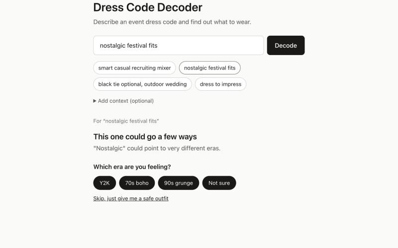

# Dress Code Decoder

Type an event dress code, such as "smart casual recruiting mixer", and get clear guidance on what to wear. When the phrase could mean quite different outfits, the app says so and asks a question or lays out the readings, instead of guessing.

**Live:** https://dress-code-decoder-one.vercel.app



## How it works

```
Browser form
   |  POST /api/decode  { description, style?, clarification? }
   v
API route ......... validates input (zod), applies a per-visitor rate limit
   v
decode() .......... system prompt + user text in delimiters
   v
Claude ............ replies by calling the `respond` tool
   v
zod ............... invalid or missing call? one repair attempt, then an error
   v
UI ................ decoded | ambiguous | off_topic
```

The model is `claude-sonnet-5-5` through the Anthropic Messages API, using the official TypeScript SDK. The key stays on the server. Set `ANTHROPIC_MODEL` to try another model.

The app is built with Next.js (App Router), TypeScript and Tailwind CSS.

| File | What's in it |
|---|---|
| `src/lib/schema.ts` | The contract shared by the API, the model and the UI |
| `src/lib/prompt.ts` | System prompt, ambiguity policy and examples |
| `src/lib/anthropic.ts` | Model call, validation and repair retry |
| `src/components/GarmentIcon.tsx` | One line icon per garment type |
| `src/lib/rateLimit.ts` | Per-visitor request limit |
| `src/app/api/decode/route.ts` | The one API endpoint |

## Prompt and output-format design

**Structured output through a tool.** The UI needs to know which of three cases it has, so the model answers by calling one tool whose input follows a schema:

- `decoded`: a short headline, formality from 1 to 5, two or three outfits, do and don't tags, a safe bet and the assumptions made.
- `ambiguous`: why it's unclear, then either a question with options or two to three interpretations, plus a "hedge" outfit that works across them.
- `off_topic`: a short redirect.

**Made to scan, not read.** Each garment has a type from a fixed list, which picks its icon, and a label of a few words. The prompt sets word limits and the schema caps length, so replies can't drift into paragraphs. Icons were chosen over photos: they're consistent, load instantly and don't show a particular body or gender.

**Two layers of checking.** Strict mode constrains the shape of the tool input. It can't express limits such as "two or three outfits" or "`ask` needs a question", so zod checks those. A failed check is sent back to the model once with the error.

**Why `tool_choice` is `auto`.** This model rejects forced tool choice and custom temperature. The prompt tells it to always call the tool, and a reply without a call goes through the same repair attempt.

**The prompt** sets a role, a five-point formality scale with how modifiers such as "smart" or "optional" shift it, guidance on informal phrasing, the ambiguity policy and style rules (describe garments, not genders; no brands or budget).

**Either, women or men.** The default is "either", which must not fall back to menswear: the first outfit is built around a dress or skirt and the second around trousers or shorts, with no gender labels. Choosing women or men keeps every outfit to that.

**Few-shot examples** show one of each behavior: a clear case, a slangy but resolvable one, an `ask` and an `options`. They are deliberately different from the test phrases and the app's example chips, so the model can't just copy them back.

**Untrusted input.** The user's text is wrapped in tags with angle brackets escaped, and the prompt treats it as data. Anything that isn't about what to wear returns `off_topic`.

**Cost.** The tool definition and system prompt are cached, and thinking effort is set to low.

## Handling vague input

The rule: flag a phrase as ambiguous **only if the plausible readings would lead to materially different outfits**. Wording that is vague but lands on much the same outfit is decoded, with the assumptions shown. A reference to an unnamed era or style ("retro") always counts as materially different.

- **Ask:** one question settles it and the person can probably answer.
- **Options:** they're unlikely to know, for example as a guest at someone else's event.
- **Hedge:** always included. In `ask` mode the person can skip the question and take it.

There is only one clarification round. Once a question is answered, the code rejects another `ambiguous` reply, so the person can't get stuck in a loop.

### Examples (real replies, abridged)

**Ask**

> **In:** nostalgic festival fits  
> **Why unclear:** Nostalgic could mean any era; each needs different clothes  
> **Question:** Which era are you channeling? `70s boho` `90s grunge` `Y2K` `Not sure`  
> **Hedge:** vintage band tee, denim cutoffs, worn-in sneakers, crossbody bag

**Options**

> **In:** themed party, host says go all out  
> **Why unclear:** Theme unknown; costume changes everything  
> **Costume party** (theme is a character or era): bold themed jacket, matching trousers, costume prop  
> **Color or glam** (theme is a color or sparkle): sequin or bright dress, statement shoes, bold jewelry  
> **Dressy theme night** (theme is Hollywood or masquerade): dark tailored jacket, sharp trousers, mask or accent  
> **Hedge:** bold solid shirt, dark tailored trousers, comfortable dressy shoes, themed accessory

## Evals

`npm run eval` sends the 32 phrases in `evals/cases.json` to the real API (it needs `ANTHROPIC_API_KEY`). Each reply is validated against the schema, then checked for the expected status and, where given, a formality range.

| Prompt version | Passed |
|---|---|
| First version, where 4 test phrases were also prompt examples | 19/20 |
| Examples replaced with unrelated phrases | 18/20 |
| Added a rule for unnamed eras and aesthetics (two runs) | 19/20, 18/20 |
| Same prompt, two expected results changed (three runs) | 20/20, 20/20, 19/20 |
| Shorter, icon-based output | 19/20 |
| Added a rule for effort-only phrases | 20/20 |

The table covers the original 20 phrases.

### Messy, real-world phrasing

People rarely type clean dress codes, so 12 more phrases add typos, slang, emoji and rambling, such as "blk tie optnl", "idk its like a work thing but at a bar??" and "no cap what do i even wear 😭". On their first run, with no prompt changes, **12 of 12** got the expected status and formality range. They hadn't been used to tune the prompt.

This was one run per phrase, checking status and formality only, not the quality of the outfits. After the style choice was added, all 32 phrases were run together once and **32 of 32** passed.

One gap it showed: for "fit check for grad", the reply assumed the person is a guest, though they could be the one graduating.

### What the earlier runs caught

**Failure found and fixed:** once its copied example was gone, "nostalgic festival fits" was decoded as if the era were known. A general rule in the ambiguity policy fixed it (6 of 6 repeat runs asked which era).

**Second failure found and fixed:** after the output was shortened, "dress to impress" was decoded as one outfit. A rule for phrases that ask for effort without naming an occasion fixed it (4 of 4 repeat runs asked).

**Expectations changed after seeing results:** "festive" and "come as you are but classy" were first expected to be ambiguous. The model decodes them with stated assumptions, and since their likely readings lead to similar outfits, that now counts as correct. The higher score in that row comes from this change, not from a better prompt.

**Known variance:** "festive" occasionally comes back as a clarifying question, which accounts for the 19/20 run.

The formality scale in the prompt names several common dress codes that are also test phrases, so the clear formal and casual cases are the easiest ones.

## Run locally

Needs Node 22 or newer and an [Anthropic API key](https://console.anthropic.com/).

```bash
npm install
cp .env.example .env.local   # then add your ANTHROPIC_API_KEY
npm run dev                  # http://localhost:3000
```

```bash
npm test           # unit tests, no API calls
npm run typecheck
npm run build
npm run eval       # makes 32 billed API calls
```

## Limitations

- The rate limit (20 requests per 10 minutes per visitor) is held in memory, so it resets on restart and isn't shared between server instances. An account spend limit is the real cap.
- Evals check status and formality, not whether the outfit advice is good.
- Replies vary between runs, and full outfit answers take several seconds.

## What I'd build next

- **Learn from use:** collect "was this helpful?" feedback and see which clarifying questions people skip.
- **Ground the slang:** retrieve real dress-code usage from event invites and forums.
- **Better evals:** more ambiguous phrases, repeated runs and a rubric for the quality of advice.
- **Faster answers:** stream responses and cache common phrases.
- **Less typing:** fill in weather from location and plan several events in one day.
- **Personal:** suggestions based on what someone already owns.
